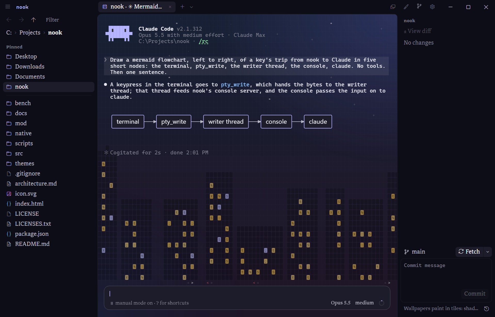
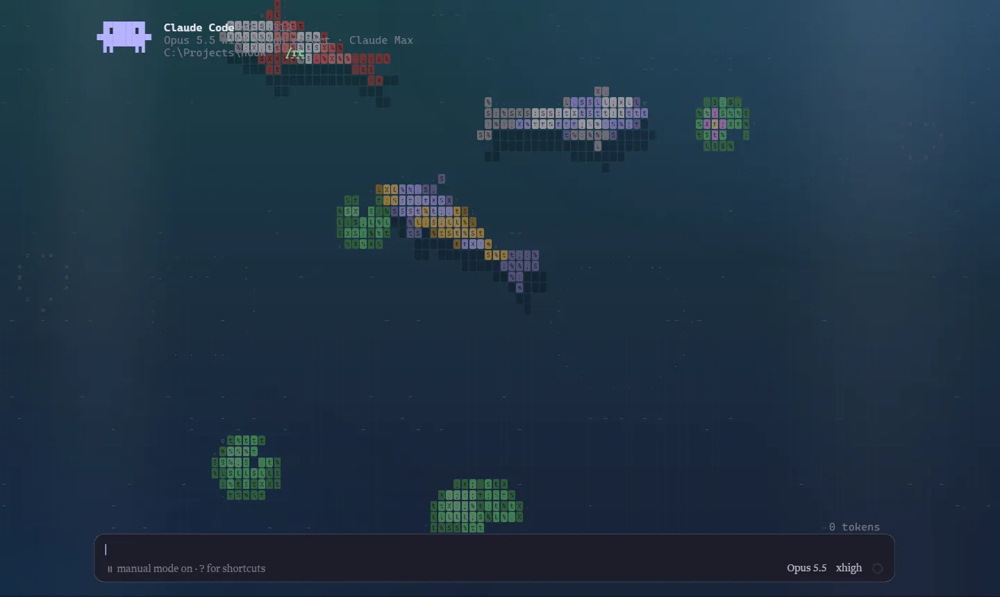
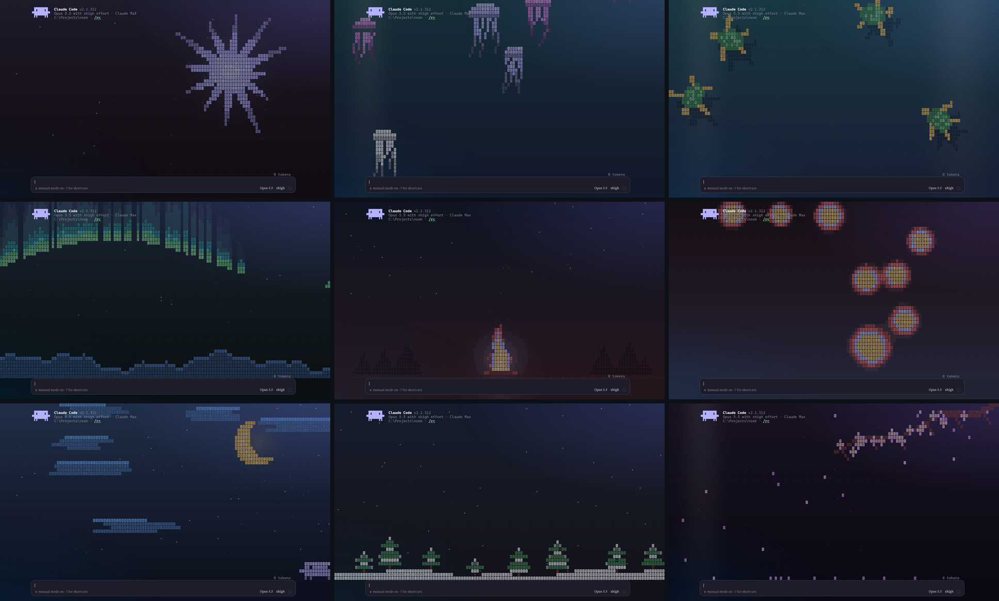

# nook

A Windows and Linux app for Claude Code. nook runs the real `claude` in terminal tabs and adds what a terminal lacks: a file browser for the whole disk, file tabs with an editor, a git panel, a dashboard of every session, pictures, diagrams, and math in the transcript, living wallpapers, and themes you restyle live.



## Install

1. Install Claude Code and sign in. In PowerShell, run `irm https://claude.ai/install.ps1 | iex`, then run `claude` once. The [Claude Code setup guide](https://code.claude.com/docs/en/setup) covers the other ways to install it.
2. Download `nook_<version>_x64-setup.exe` from [the latest release](https://github.com/Skyway1111/nook/releases/latest) and run it. nook installs for your Windows account only, so it needs no admin rights.
3. The installer isn't code-signed, so Windows SmartScreen may warn about it. Click **More info**, then **Run anyway**.

nook runs on 64-bit Windows 10 1809 or later and on Windows 11. The git panel needs [Git for Windows](https://git-scm.com/downloads/win).

On Linux, build nook from source, as **Build from source** below says. It needs WebKitGTK 4.1 and GTK 3, and the git panel needs `git`. A PDF Claude reads shows its first page only with `libpoppler-glib8` installed. Claude Code reads a pasted screenshot through `xclip` on X11 or `wl-paste` on Wayland, so install the one for your session.

## What nook adds

### Claude sessions

- **Claude in tabs.** Click **+**, press Ctrl+N, or right-click a folder and pick **New Claude session here**. Each tab runs Claude's own interface, unchanged. The chevron beside **+** continues the folder's last session, resumes a saved one, or starts one in a git worktree of its own. Started without a folder, nook reopens the sessions that were open when it closed.
- **Open with nook.** In Explorer, right-click a folder, or the empty space inside one, and pick **Open with nook**.
- **A prompt card.** The prompt shows in a card with the model, the effort, and a ring for how full the context is. Pick a model or an effort from the card's menus.
- **Every session at a glance.** Each tab shows whether its session is working, waiting on you, or done, and a session in the background that needs you or finishes says so on the desktop. Ctrl+Shift+S opens the sessions dashboard, a card per session: what it's doing, its prompt and plan, its context and cost, and the files it wrote, under the account's rate limits. From a card, allow or deny a permission prompt, compact the session, or review everything it changed in one diff.
- **One prompt, many sessions.** The dashboard's prompt box sends a prompt to every session you tick, each taking it when its turn ends, or to several new sessions, each in a git worktree of its own, so they try it side by side. Keep the best one's changes, staged in your checkout, and discard the rest, branch and all.
- **Quick prompts.** Ctrl+Shift+P puts a saved prompt, or one of Claude's slash commands and skills, into the prompt to edit. `{file}` in a saved prompt is the file you showed last, and `{folder}` the file browser's folder.
- **Side by side.** Ctrl+\ or a tab's **Open beside** splits the pane, so two sessions, or a session and a file, show at once.
- **Focus mode.** F11 hides everything but Claude, in a column over the wallpaper.
- **Claude sees what you're looking at.** Each Claude tab is its Claude's IDE: Claude knows the file you showed last and the lines you picked in it, and Ctrl+Alt+K names those lines in its prompt. An edit Claude asks permission for opens beside it as a diff, with **Accept** and **Reject**.
- **Paths in and out.** Drag a file from the sidebar or from Explorer into the terminal to add its path to your prompt, or Ctrl+V files you copied. Rest the mouse on a path in Claude's output to see the lines it points at, and Ctrl+click it to open the file at that line.
- **Pasted screenshots.** Ctrl+V pastes a screenshot straight into Claude. Hover `[Image #N]` to see the image, and click it to open it.
- **Find in a session.** Ctrl+Shift+F finds text through a session's whole transcript, and Ctrl+Shift+Up and Down jump between the prompts you sent, in Claude's fullscreen view too.

### Claude's transcript

- **Pictures.** Each image you paste shows under your prompt, and each image, SVG, or PDF Claude reads shows under the `Read`, as do the pictures a command saves and the ones a reply links. Any program that draws kitty, sixel, or iTerm2 pictures draws them in its tab.
- **Diagrams and math.** A mermaid block in a reply draws as a diagram in the theme's colors: a flowchart, a sequence, class, state, or ER diagram, a pie or Gantt chart, a mind map, a timeline, a journey, or a git graph. A display formula is typeset, inline math reads as plain symbols, an SVG block draws under its source, and an HTML page Claude writes shows under its `Write`. nook tells Claude what it can draw.
- **What each step did.** Under a shell command, how it went: a test run's counts and the tests that failed, the error, what a build, install, linter, or git did, and how long a slow one took. Under a folded run of calls, the files Claude read, each a link, and what each search found. Under a web search, the sites it found.
- **Copy, Run, and Undo.** Each code block in a reply has a Copy, and a one-line shell block a Run, which types it into the prompt as a `!` command for you to send. Each of Claude's edits has an Undo, then a Redo. After a turn that edited files, a band over the prompt offers **Review**, which opens the turn's changes in one diff, and **Undo turn**.

### Files and code

- **A file browser for the whole disk**, with pins, breadcrumbs, back and forward, and a typed path bar. Right-click a file to cut, copy, rename, or delete it. A deleted file goes to the Recycle Bin, or on Linux to the trash. Ctrl+click or Shift+click picks several files at once. Drag files onto a folder, a pin, or a folder in the path bar to move them there, or hold Ctrl as you drop to copy them. Files dropped from Explorer onto a folder are copied into it. A folder of 100,000 files opens as fast as one of 100. Ctrl+Shift+E moves through the list with the keys: arrows, Enter, Backspace to go up, and the first letters of a name to jump to it. The Filter box beside the arrows, or Ctrl+F in the list, shows only the names holding what you type. With the git panel open, changed files take git's colors: yellow for modified, green for new, red for a conflict, and a folder holding a change a fainter yellow. A file Claude wrote in an open session has a dot, and its menu shows **Claude's changes**.
- **Quick open.** Ctrl+P finds any file in the open tab's repository, or its folder outside one, by a few letters of its name. Files you opened lately come first. Enter opens it, Shift+Enter adds its path to Claude's prompt, and Alt+Enter shows it in the file browser. Type `:` and a number to go to a line, `@` to go to a function, class, or heading in the open file (Ctrl+Shift+O), `#` to go to where a name is defined anywhere in the repository (Ctrl+T in a file), or `%` and some text to find it inside the files: each matching line shows with its file and line number, and Enter opens the file there.
- **Go to definition.** F12 in a file goes to where the word at the caret is defined: straight there when the repository, or the open file, defines it once, and otherwise to a list of the places, the open file's first. Alt+Left goes back. nook reads definitions by their lines (functions, classes, methods, types, constants, and Markdown headings) in JavaScript and TypeScript, Python, Rust, Go, Java and its kin, C and C++, Ruby, shell and Lua, so it needs no language server and finds a definition in a dozen milliseconds on a first look and one or two after.
- **A command palette.** F1, or `>` in quick open, runs any of nook's commands by name. Type `theme` or `wallpaper` to switch either there: nook shows each one as you move onto it, and Esc puts yours back.
- **File tabs.** Click a file to open it in a tab. Code and text open in an editor with syntax colors. Markdown, CSV and TSV, SVG, and HTML without scripts open rendered, with an **Edit** button: a CSV or TSV as a table that sorts by any column and scrolls tens of thousands of rows as smoothly as a hundred, and an SVG drawn live from its text. Images zoom with the wheel and pan with a drag, audio and video play, and PDFs open in the webview's own viewer.
- **An editor for code.** Fold any block from the gutter, get brackets closed and words completed as you type, add cursors with Ctrl+D, Ctrl+Alt+Up and Down, or Alt+drag, and see the caret, language, indent, and line ending in a line under the text. Alt+Z wraps long lines. In a git repository, bars beside the line numbers mark the lines you've added (green) and changed (yellow) and where lines were taken out (red), against what's staged, unsaved edits included, as you type. Alt+B shows in the gutter who last changed each run of lines.
- **Safe edits.** An open file follows changes on disk. If Claude changes a file while you have unsaved edits, nook keeps your edits and offers **Overwrite** or **Reload**.
- **Find and replace across files.** Ctrl+Shift+H (or Ctrl+Shift+F outside a Claude tab) opens a search tab for the open tab's repository or folder. Every match shows under its file, with what it becomes struck through beside the replacement. Toggle case, whole words, and regular expressions (Alt+C, Alt+W, Alt+R), where `$1` in the replacement takes a group. Narrow it to some files with `*.js, src/, !test`. Leave out a match or a whole file with its ×, then Replace (Ctrl+Enter) rewrites the rest. A file changed since the search, or with unsaved edits in a tab, is left alone and named, and Undo puts back what the replace changed.

### Git

- **A git panel** for the open tab's repository. Stage files, commit, switch or create branches, and fetch, pull, or push with git's progress on the button. Make a stash, see what it holds, and apply, pop, or drop it.
- **Diffs.** The diff tab shows staged and unstaged changes in syntax colors, unified or side by side, and stages, unstages, or discards a hunk or just the lines you pick in it.
- **History.** The history tab draws every branch's commits as a graph, searches them, shows each commit's message and changes, and checks out, branches from, cherry-picks, or reverts one.
- **Merges.** A conflicted file opens in a merge tab with each conflict's sides next to each other, settled by taking one or both. The panel continues or aborts the merge or rebase.

### Look

- **Living wallpapers.** Eighteen scenes behind Claude, always moving, painted in tiles. See **Wallpapers** below.
- **Themes.** Pick a theme, re-hue the whole app, pick its accent and terminal colors, turn the wallpaper up or down or slow it, pick the interface and terminal fonts, and write CSS that restyles any part of nook as you type. Claude's own colors can follow the theme. See **Themes** below.
- **Fast typing under load.** nook renders on the CPU, and on Windows it runs its typing path at above-normal priority, so typing stays fast while a training run saturates the GPU or the CPU.

## Wallpapers

Click the brush in the titlebar to pick a scene to live behind Claude. Each is painted in tiles: shaded blocks with a character cut in each, over a wash of the scene's own light, in the colors of the theme in use.



There are eighteen: a turning spark, drifting clouds, sea turtles, a koi pond, jellyfish, paper boats, fireflies, a moonlit night, rain, an aurora, snowfall, a campfire, a lava lamp, orbiting planets, code rain, cherry blossoms, a night sea, and city lights.



Arrows preview a scene, Enter keeps it, and Esc puts back the last one. The wallpaper holds still while nook is in the background or resizing. Sliders under the scenes, and in Settings, set how strongly it shows and how fast it moves. A slower one draws fewer frames, and one at no strength isn't drawn at all, so both cost less. Tick **Move only while Claude works** and it holds still until a Claude session in that window is working, so it shows at a glance when Claude is busy and costs nothing while Claude rests. In `theme.css`, `--wallpaper` names the scene and `--wallpaper-<role>` colors each part of it.

## Keys

| Key | Action |
|---|---|
| Ctrl+V | Paste text, or attach a screenshot or the files you copied |
| Shift+Enter | New line in the prompt |
| Ctrl+C | Copy the selection. With nothing selected, Claude gets it. |
| Ctrl+N | New Claude session in the file browser's folder |
| Ctrl+Shift+S | The sessions dashboard |
| Ctrl+Shift+P | Quick prompts: a saved prompt, or one of Claude's slash commands |
| Ctrl+P | Quick open: find a file, `>` for commands, `:` for a line, `#` for a definition, `%` for text in files |
| F1 | Run a command |
| F11 | Focus mode: no panels or titlebar buttons, each Claude tab a centered column over the wallpaper. `--focus-width` in theme.css sets the column. F11 again, or the Focus pill, leaves it. |
| Ctrl+Shift+F | In a Claude tab: find in the transcript. Elsewhere, find across files. |
| Ctrl+Shift+Up, Ctrl+Shift+Down | In a Claude tab: the previous or next prompt you sent |
| Ctrl+click a path | In a Claude tab: open the file at its line, or the folder in the file browser |
| F12 | In a file: go to where the word at the caret is defined. Alt+Left goes back. |
| Ctrl+T | In a file: go to a definition anywhere in the repository by name |
| Ctrl+Alt+K | In a file: name the picked lines in Claude's prompt |
| Ctrl+Shift+H | Find and replace across the folder's files, in a search tab |
| Ctrl+Shift+O | Go to a function, class, or heading in the open file. The arrows show each in the editor, and Esc goes back. |
| Ctrl+Shift+E | Move through the file browser with the keys. Shift+arrows pick, Space picks one, F2 renames, Delete deletes, Ctrl+Enter adds to Claude's prompt, Ctrl+F or / filters by name, Esc gives the keys back. |
| Ctrl+Tab, Ctrl+Shift+Tab | Next or previous tab |
| Ctrl+1 to Ctrl+8, Ctrl+9 | Show that tab, or the last one |
| Ctrl+\ | Split the pane, or join it again |
| Ctrl+S | Save the open file |
| Ctrl+F | Find and replace in the editor |
| Ctrl+D | Select the next match of the selection, as another cursor |
| Ctrl+Shift+[, Ctrl+Shift+] | Fold or unfold the block at the caret |
| Alt+Z | Wrap long lines in the editor, or stop wrapping them |
| Alt+B | Show or hide blame in the editor's gutter |
| Ctrl+W | Close a file tab. In a Claude tab, Claude gets it. |
| Middle-click a tab | Close it |
| Ctrl+Enter | Commit, from the commit message box |
| Mouse back and forward | File browser history |

## Settings

Click the gear in the titlebar. The Settings drawer edits two files in `%APPDATA%\dev.nook.app`, or on Linux in `~/.config/dev.nook.app`. An edit made in any other editor shows in the drawer within a second.

- `settings.json`: **Command** is what each Claude tab runs, one argument per line. The default starts `claude` in Windows PowerShell, or on Linux in a bash login shell. If you have PowerShell 7, change `powershell` to `pwsh`. **Render with the GPU** takes effect after a restart. The file also holds your quick prompts (`prompts`), and `reopenSessions` and `notifications`, which you can set to `false`.
- `theme.css`: your CSS, applied over nook's defaults and the theme in use, as you type. The hue, color, wallpaper, font, and size controls write their variables here. **nook's defaults** lists every variable.

To push and fetch over HTTPS, click **Sign in** under GitHub in the same drawer. Git Credential Manager, which ships with Git for Windows, keeps the token. nook never sees it.

## Themes

**Theme** in the Settings drawer shows a card for each installed theme. Rest the pointer on one to see nook in it, and click to use it in every window. A card's share button saves that theme as a .zip in Downloads, ready for anyone's **Install…**. nook ships with eleven themes. Twilight sets Frederic Edwin Church's painting *Twilight in the Wilderness* behind the window. Fjord, Ember, Phosphor, and Sakura are color only: slate and frost, charcoal and coals, an old green screen, and plum with petal pink. Paper is the light one, for daylight. Contrast is pure black and white, with bright colors, solid lines, and a thick focus ring, for eyes that want every edge sharp. Catppuccin (Mocha), Gruvbox, Tokyo Night, and Dracula follow those well-known palettes, so nook matches an editor or terminal already in them. A newer nook adds the themes it ships without bringing back one you removed.

With **Match the system's light and dark** on, nook keeps one theme for each: the one you pick while the system is light is its day theme, and the one you pick while it's dark is its night theme, and nook switches between them as the system does. Turning it on starts the other side as Paper by day, or nook's own by night.

To make a theme from any photo or painting, click **From a picture…**. nook reads the picture's own palette and builds the theme from it, in the window, with nothing uploaded.

To install a theme, click **Install…** and pick its .zip, or right-click a theme's folder or .zip in the file browser and pick **Install theme**. Your own `theme.css` applies over the theme, so your fonts and sizes stay when you switch.

With **Claude's colors follow the theme** on, picking a theme also sets Claude's own theme to nook's. nook writes only the `theme` key of `~/.claude/settings.json`, the key `/theme` writes, and puts your Claude theme back when you turn this off. Claude reads its theme when it starts, so restart open Claude tabs to recolor them.

To make your own theme, follow [Make a theme](docs/themes.md).

## How nook works with Claude Code

nook starts each Claude session in a pseudoterminal and draws it in a terminal of its own. Every key you type goes to Claude. nook never edits your prompt or Claude's output.

Each session nook starts also loads a small Claude Code plugin from `mod`. The plugin tells its tab the model, the effort, how full the context is, and what the session is doing. It runs the model and effort you pick from the prompt card, tells Claude what nook can draw, and adds the pictures, diagrams, and notes under Claude's drawing. It passes every event on unchanged, and sessions you start outside nook never load it.

nook is Rust and JavaScript with no dependencies: its own window over WebView2, or WebKitGTK on Linux, its own terminal, and on Windows its own console server. [architecture.md](architecture.md) maps the code.

## Build from source

You need [Node.js](https://nodejs.org) 22 or later and [Rust](https://rustup.rs), with the GNU or the MSVC toolchain on Windows. On Debian or Ubuntu, also run `sudo apt install libwebkit2gtk-4.1-dev libgtk-3-dev build-essential`.

```powershell
npm run dev      # a debug build that loads the page from src/ as you edit it. To start in a folder: npm run dev -- -- <folder>
npm run build    # nook and its installer, or on Linux a .deb, in native/target/release. Add -- --no-pack to skip the installer.
npm test         # the page's tests
cd native; cargo test
```

On Linux, build nook as the benches' own identity, `NOOK_ID=dev.nook.bench npm run build -- --no-pack`, and `node bench/linux.mjs --wallpapers none,koi` measures it: open time and where it goes, resize, key echo, scroll, and output flood times, idle and typing CPU, and memory. Give it two builds, `--bin <base>,<new>`, and it alternates their launches and flags each number that got worse than its noise, printed after the ± beside each change: a number that swings from session to session needs a bigger change to count. It needs Xvfb, xdotool and python3. In bench/tui.mjs, a stand-in for Claude's fullscreen view, key echo is timed on the screen, by the pixels of the composer's draft.

Before merging, `npm run gate` builds this tree and `origin/main` (main once per commit, kept in `~/.cache/nook-bench`) and runs that bench's `--quick` mode on them in about five minutes. It adds the koi wallpaper, Claude's fullscreen view, or a repository with a large diff only when the change touches what they measure, and gives a number more launches only when its change comes close to its bar. The full run above stays the occasional, thorough check.

On Windows, `npm run bench:windows` builds the commit the overnight R&D began from (PR #1's merge) and the newest `origin/main`, then compares their open, resize, idle CPU and memory on your machine, with and without a wallpaper. Each build runs as `dev.nook.bench`, with its own settings and WebView2 profile, so your nook can stay open, though its work is noise in the numbers. `--base`, `--new` or `--exe base.exe,new.exe` pick other builds. An `--exe` has to be built as `dev.nook.bench` too.

On Windows, close a debug nook before you rebuild it: Windows locks the exe it runs from.

## Credits

- [Libron](https://github.com/nicoverbruggen/libron), the interface font, is under the SIL Open Font License.
- On Linux, the icons are Microsoft's [Fluent UI System Icons](https://github.com/microsoft/fluentui-system-icons), under the MIT License.
- nook's console server follows Microsoft's OpenConsole, from [Windows Terminal](https://github.com/microsoft/terminal), under the MIT License.
- Parts of the terminal come from [xterm.js](https://github.com/xtermjs/xterm.js), and the Markdown grammar from [marked](https://github.com/markedjs/marked), both under the MIT License.
- Twilight's picture is *Twilight in the Wilderness* (1860) by Frederic Edwin Church. The Cleveland Museum of Art released its photograph under [CC0](https://clevelandart.org/art/1965.233).

[LICENSES.txt](LICENSES.txt) holds the notices those licenses ask for, and ships beside nook.

nook isn't affiliated with Anthropic. Claude and Claude Code are trademarks of Anthropic.

## License

[MIT](LICENSE)
