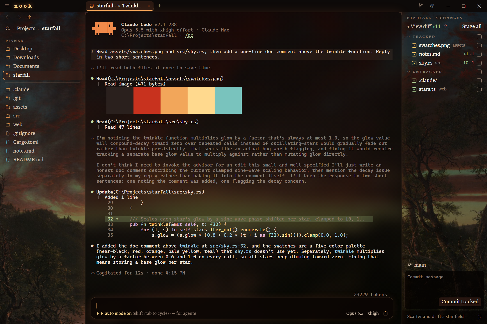

# nook

A Windows and Linux app for Claude Code. nook runs the real `claude` in terminal tabs and adds what a terminal lacks: a file browser for the whole disk, file tabs with an editor, a git panel, pasted screenshots, pictures in the transcript, and themes you restyle live.



## Install

1. Install Claude Code and sign in. In PowerShell, run `irm https://claude.ai/install.ps1 | iex`, then run `claude` once. The [Claude Code setup guide](https://code.claude.com/docs/en/setup) covers the other ways to install it.
2. Download `nook_<version>_x64-setup.exe` from [the latest release](https://github.com/Skyway1111/nook/releases/latest) and run it. nook installs for your Windows account only, so it needs no admin rights.
3. The installer isn't code-signed, so Windows SmartScreen may warn about it. Click **More info**, then **Run anyway**.

nook runs on 64-bit Windows 10 1809 or later and on Windows 11. The git panel needs [Git for Windows](https://git-scm.com/downloads/win).

On Linux, build nook from source, as **Build from source** below says. It needs WebKitGTK 4.1, `git`, `unzip`, `xdg-open`, and `gio` for the trash. Claude Code reads a pasted screenshot through `xclip` on X11 or `wl-paste` on Wayland, so install the one for your session.

## What nook adds

- **Claude in tabs.** Click **+**, press Ctrl+N, or right-click a folder and pick **New Claude session here**. Each tab runs Claude's own interface, unchanged.
- **Open with nook.** In Explorer, right-click a folder, or the empty space inside one, and pick **Open with nook**.
- **A file browser for the whole disk**, with pins, breadcrumbs, back and forward, and a typed path bar. Right-click a file to cut, copy, rename, or delete it. A deleted file goes to the Recycle Bin, or on Linux to the trash. Ctrl+click or Shift+click picks several files at once. Drag files onto a folder, a pin, or a folder in the path bar to move them there, or hold Ctrl as you drop to copy them. Files dropped from Explorer onto a folder are copied into it. A folder of 100,000 files opens as fast as one of 100. Ctrl+Shift+E moves through the list with the keys: arrows, Enter, Backspace to go up, and the first letters of a name to jump to it. The Filter box beside the arrows, or Ctrl+F in the list, shows only the names holding what you type. With the git panel open, changed files take git's colors: yellow for modified, green for new, red for a conflict, and a folder holding a change a fainter yellow.
- **Quick open.** Ctrl+P finds any file in the open tab's repository, or its folder outside one, by a few letters of its name. Files you opened lately come first. Enter opens it, Shift+Enter adds its path to Claude's prompt, and Alt+Enter shows it in the file browser. Type `:` and a number to go to a line, `@` to go to a function, class, or heading in the open file (Ctrl+Shift+O), or `%` and some text to find it inside the files: each matching line shows with its file and line number, and Enter opens the file there.
- **A command palette.** F1, or `>` in quick open, runs any of nook's commands by name. Type `theme` to switch themes there: nook shows each one as you move onto it, and Esc puts yours back.
- **Paths into the prompt.** Drag a file from the sidebar or from Explorer into the terminal to add its path to your prompt.
- **Pasted screenshots.** Ctrl+V pastes a screenshot straight into Claude. Hover `[Image #N]` to see the image, and click it to open it.
- **Pictures in the transcript.** Each image you paste shows under your prompt, and each image or SVG Claude reads shows under the `Read`.
- **A prompt card.** The prompt shows in a card with the model, the effort, and a ring for how full the context is. Pick a model or an effort from the card's menus.
- **File tabs.** Click a file to open it in a tab. Code and text open in an editor with syntax colors, Markdown, CSV and TSV, and SVG open rendered with an **Edit** button: a CSV or TSV as a table that sorts by any column and scrolls tens of thousands of rows as smoothly as a hundred, and an SVG drawn live from its text. Images zoom with the wheel and pan with a drag, audio and video play, and PDFs open in the webview's own viewer.
- **An editor for code.** Fold any block from the gutter, get brackets closed and words completed as you type, add cursors with Ctrl+D, Ctrl+Alt+Up and Down, or Alt+drag, and see the caret, language, indent, and line ending in a line under the text. Alt+Z wraps long lines.
- **Safe edits.** An open file follows changes on disk. If Claude changes a file while you have unsaved edits, nook keeps your edits and offers **Overwrite** or **Reload**.
- **A git panel** for the open tab's repository. Stage files, commit, switch or create branches, and fetch, pull, or push. Its diff tab shows staged and unstaged changes in syntax colors, unified or side by side, and stages, unstages, or discards a hunk or just the lines you pick in it. Its history tab draws every branch's commits as a graph, searches them, shows each commit's message and changes, and checks out, branches from, cherry-picks, or reverts one.
- **Living wallpapers.** Click the brush in the titlebar to pick a scene drawn in characters behind Claude, always moving: drifting clouds, sea turtles, a koi pond, jellyfish, paper boats, fireflies, a moonlit night, rain, an aurora, snowfall, a campfire, a lava lamp, orbiting planets, code rain, cherry blossoms, a moonlit sea, or city lights. Arrows preview a scene, Enter keeps it, and Esc puts back the last one. The wallpaper holds still while you type and while nook is in the background. Sliders under the scenes, and in Settings, set how strongly it shows and how fast it moves. A slower one draws fewer frames, and one at no strength isn't drawn at all, so both cost less. Tick **Move only while Claude works** and it holds still until a Claude session in that window is working, so it shows at a glance when Claude is busy and costs nothing while Claude rests.
- **Themes.** Pick a theme, re-hue the whole app, pick its accent and terminal colors, turn the wallpaper up or down or slow it, pick the interface and terminal fonts, and write CSS that restyles any part of nook as you type. Claude's own colors can follow the theme.
- **Fast typing under load.** On Windows, nook renders on the CPU and runs its typing path at above-normal priority, so typing stays fast while a training run saturates the GPU or the CPU.

## Keys

| Key | Action |
|---|---|
| Ctrl+V | Paste text, or attach a screenshot |
| Shift+Enter | New line in the prompt |
| Ctrl+C | Copy the selection. With nothing selected, Claude gets it. |
| Ctrl+N | New Claude session in the file browser's folder |
| Ctrl+P | Quick open: find a file, `>` for commands, `:` for a line, `%` for text in files |
| Ctrl+Shift+O | Go to a function, class, or heading in the open file. The arrows show each in the editor, and Esc goes back. |
| F1 | Run a command |
| Ctrl+Shift+E | Move through the file browser with the keys. Shift+arrows pick, Space picks one, F2 renames, Delete deletes, Ctrl+Enter adds to Claude's prompt, Ctrl+F or / filters by name, Esc gives the keys back. |
| Ctrl+Tab, Ctrl+Shift+Tab | Next or previous tab |
| Ctrl+S | Save the open file |
| Ctrl+F | Find and replace in the editor |
| Ctrl+D | Select the next match of the selection, as another cursor |
| Ctrl+Shift+[, Ctrl+Shift+] | Fold or unfold the block at the caret |
| Alt+Z | Wrap long lines in the editor, or stop wrapping them |
| Ctrl+W | Close a file tab. In a Claude tab, Claude gets it. |
| Middle-click a tab | Close it |
| Ctrl+Enter | Commit, from the commit message box |
| Mouse back and forward | File browser history |

## Settings

Click the gear in the titlebar. The Settings drawer edits two files in `%APPDATA%\dev.nook.app`, or on Linux in `~/.config/dev.nook.app`. An edit made in any other editor shows in the drawer within a second.

- `settings.json`: **Command** is what each Claude tab runs, one argument per line. The default starts `claude` in Windows PowerShell, or on Linux in a bash login shell. If you have PowerShell 7, change `powershell` to `pwsh`. **Render with the GPU** takes effect after a restart.
- `theme.css`: your CSS, applied over nook's defaults and the theme in use, as you type. The hue, color, wallpaper, font, and size controls write their variables here. **nook's defaults** lists every variable.

To push and fetch over HTTPS, click **Sign in** under GitHub in the same drawer. Git Credential Manager, which ships with Git for Windows, keeps the token. nook never sees it.

## Themes

**Theme** in the Settings drawer shows a card for each installed theme. Rest the pointer on one to see nook in it, and click to use it in every window. A card's share button saves that theme as a .zip in Downloads, ready for anyone's **Install…**. nook ships with seven themes. Twilight sets Frederic Edwin Church's painting *Twilight in the Wilderness* behind the window. Fjord, Ember, Phosphor, and Sakura are color only: slate and frost, charcoal and coals, an old green screen, and plum with petal pink. Paper is the light one, for daylight. Contrast is pure black and white, with bright colors, solid lines, and a thick focus ring, for eyes that want every edge sharp. A newer nook adds the themes it ships without bringing back one you removed.

With **Match the system's light and dark** on, nook keeps one theme for each: the one you pick while the system is light is its day theme, and the one you pick while it's dark is its night theme, and nook switches between them as the system does. Turning it on starts the other side as Paper by day, or nook's own by night.

To make a theme from any photo or painting, click **From a picture…**. nook reads the picture's own palette and builds the theme from it, in the window, with nothing uploaded.

To install a theme, click **Install…** and pick its .zip, or right-click a theme's folder or .zip in the file browser and pick **Install theme**. Your own `theme.css` applies over the theme, so your fonts and sizes stay when you switch.

With **Claude's colors follow the theme** on, picking a theme also sets Claude's own theme to nook's. nook writes only the `theme` key of `~/.claude/settings.json`, the key `/theme` writes, and puts your Claude theme back when you turn this off. Claude reads its theme when it starts, so restart open Claude tabs to recolor them.

To make your own theme, follow [Make a theme](docs/themes.md).

## How nook works with Claude Code

nook starts each Claude session in a pseudoterminal and draws it with xterm.js. Every key you type goes to Claude. nook never edits your prompt or Claude's output.

Each session nook starts also loads a small Claude Code plugin from `src-tauri/mod`. The plugin tells its tab the model, the effort, and how full the context is. It runs the model and effort you pick from the prompt card, and adds the pictures under Claude's drawing. It passes every event on unchanged, and sessions you start outside nook never load it.

[architecture.md](architecture.md) maps the code.

## Build from source

You need [Node.js](https://nodejs.org) 20.19 or later, [Rust](https://rustup.rs), and the [Tauri prerequisites](https://v2.tauri.app/start/prerequisites/) for your system. On Debian or Ubuntu, those are `sudo apt install libwebkit2gtk-4.1-dev libgtk-3-dev librsvg2-dev libayatana-appindicator3-dev build-essential`.

```powershell
npm install
npm run dev      # a debug build. To start in a folder: npm run dev -- -- <folder>
npm run build    # nook.exe and the installer, or on Linux nook, a .deb, and an AppImage, in src-tauri/target/release
npm test         # the frontend's tests: the wallpapers' scenes and both systems' path rules
cd src-tauri; cargo test
```

On Linux, `node bench/linux.mjs --bin <nook> --wallpapers none,koi` measures a release build: open time and where it goes, resize, key echo, scroll, and output flood times, idle and typing CPU, and memory. Give it two builds, `--bin <base>,<new>`, and it alternates their launches and flags each number that got worse than its noise, printed after the ± beside each change: a number that swings from session to session needs a bigger change to count. It needs Xvfb, xdotool and python3. In bench/tui.mjs, a stand-in for Claude's fullscreen view, key echo is timed on the screen, by the pixels of the composer's draft.

Before merging, `npm run gate` builds this tree and `origin/main` (main once per commit, kept in `~/.cache/nook-bench`) and runs that bench's `--quick` mode on them in about five minutes. It adds the koi wallpaper, Claude's fullscreen view, or a repository with a large diff only when the change touches what they measure, and gives a number more launches only when its change comes close to its bar. The full run above stays the occasional, thorough check.

On Windows, `npm run bench:windows` builds the commit the overnight R&D began from (PR #1's merge) and the newest `origin/main`, then compares their open, resize, idle CPU and memory on your machine, with and without a wallpaper. Close nook first: while the bench runs, your settings folder moves aside and comes back when it ends. `--base`, `--new` or `--exe base.exe,new.exe` pick other builds.

Before a build you publish, run `$env:RUSTFLAGS = "--remap-path-prefix=$env:USERPROFILE=~"`. Without it, `nook.exe` holds your home folder's path in each of its dependencies' source paths.

If a debug nook is open, close it before you rebuild. The build copies `conpty.dll` and `OpenConsole.exe` over the files the running nook holds open, and fails with os error 32.

## Credits

- [Libron](https://github.com/nicoverbruggen/libron), the interface font, is under the SIL Open Font License. See `src/fonts/OFL.txt`.
- On Linux, the icons are Microsoft's [Fluent UI System Icons](https://github.com/microsoft/fluentui-system-icons), under the MIT License. See `src/fonts/FluentIcons-LICENSE.txt`.
- `conpty.dll` and `OpenConsole.exe` come from Microsoft's `Microsoft.Windows.Console.ConPTY` package, under the MIT License. See `src-tauri/conpty/LICENSE`.
- Twilight's picture is *Twilight in the Wilderness* (1860) by Frederic Edwin Church. The Cleveland Museum of Art released its photograph under [CC0](https://clevelandart.org/art/1965.233).

nook isn't affiliated with Anthropic. Claude and Claude Code are trademarks of Anthropic.

## License

[MIT](LICENSE)
